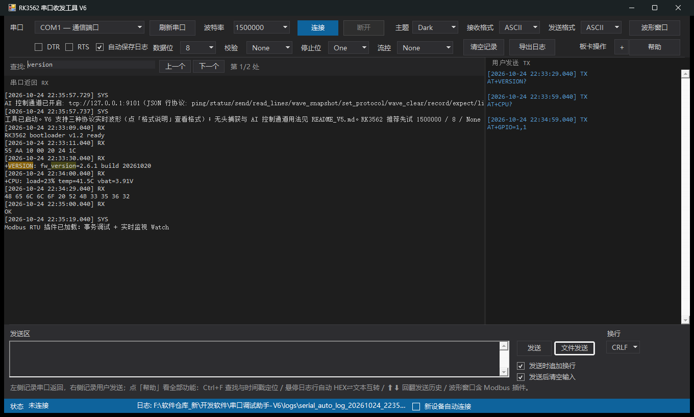
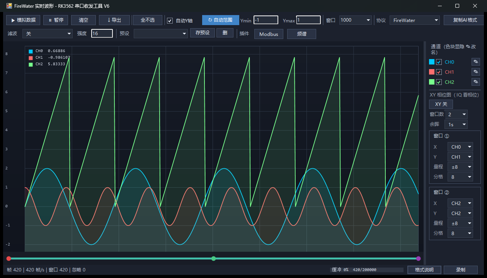
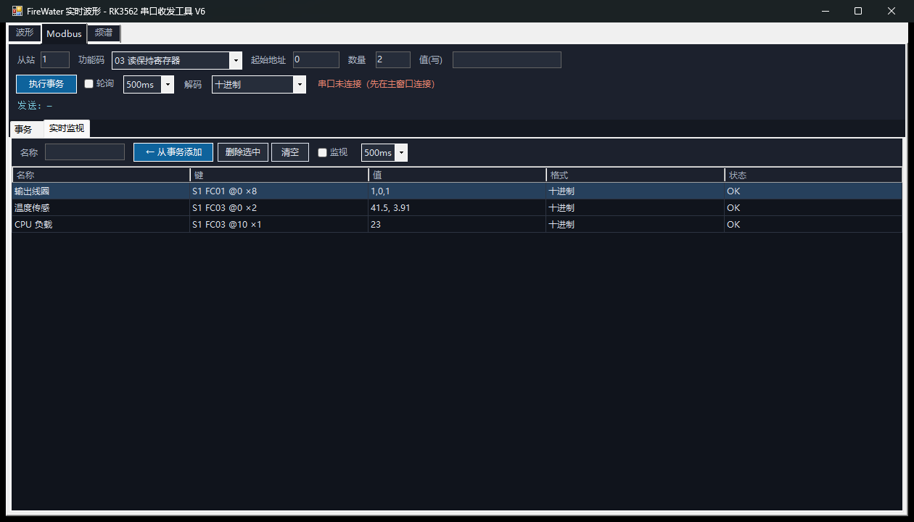
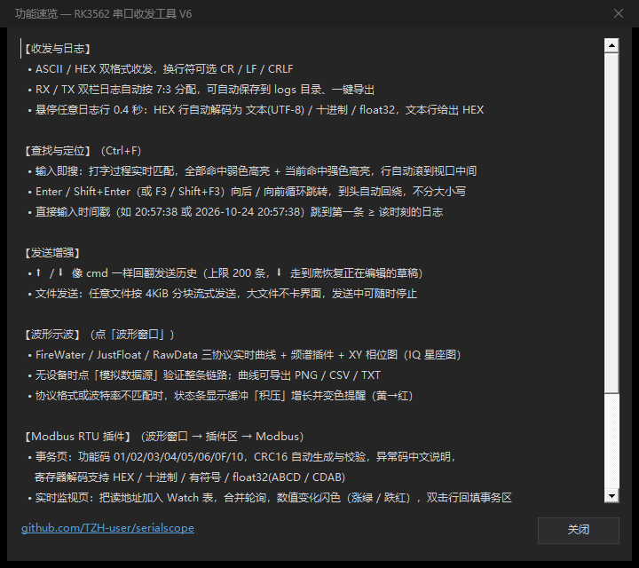

# serialscope · RK3562 串口收发工具 V6


**一个单脚本、免安装的串口调试终端**：收发日志、HEX⇄文本互转、三种协议实时波形（FireWater / JustFloat / RawData）、日志查找与时间戳定位、文件发送、命令历史，并带一套插件框架——内置 **Modbus RTU 主站调试台**（事务 + 实时 Watch）与频谱仪。面向 RK3562 / STM32 等嵌入式联调，双击即用。

| 主窗口（查找高亮 + 悬停互转） | 波形窗口（FireWater 三通道） |
|---|---|
|  |  |

| Modbus RTU 实时监视 | 功能速览（帮助按钮） |
|---|---|
|  |  |

---

## ✨ 功能一览

### 收发与日志
- ASCII / HEX 双格式收发，换行符可选 CR / LF / CRLF
- **无换行也不丢**：板卡发送不带换行符时，残行静默约 0.5 秒自动落显（不用等 8KB 强制线）
- RX / TX 双栏日志自动 7:3 分配；自动保存到 `logs\`，可一键导出
- **悬停互转**：鼠标停在任意日志行 0.4 秒，HEX 行自动解码为 文本(UTF-8) / 十进制 / float32(小端)，文本行给出 UTF-8 HEX（悬停条目头行等效于悬停其正文）
- STM32 HardFault 寄存器串自动解码

### 查找与定位（Ctrl+F）
- **输入即搜**：打字过程 150ms 防抖实时匹配，全部命中弱色高亮 + 当前命中强色高亮，命中行自动滚到视口中间
- Enter / Shift+Enter（或 F3 / Shift+F3）向后 / 向前循环跳转，到头自动回绕，不分大小写，计数显示「第 m/N 处」
- **时间戳定位**：直接输入 `20:57` / `20:57:38.5` / `2026-10-24 20:57:38`，跳到第一条 ≥ 该时刻的日志条目（只给时刻时日期取日志首条）

### 发送增强
- **⬆ / ⬇ 回翻发送历史**（cmd 风格）：上限 200 条，⬇ 走到底恢复正在编辑的草稿；多行编辑时方向键仍是移动光标
- **文件发送**：任意文件按 4KiB 分块流式发送（20ms 间隔），大文件不卡界面，发送中再点一次即停止
- 发送后自动清空输入（可选）、发送时追加换行（可选）

### 波形示波（点「波形窗口」）
- **FireWater / JustFloat / RawData** 三协议实时曲线，窗口 1000 帧可调、自动/手动 Y 轴、滤波、导出 PNG / CSV / TXT
- 频谱插件（FFT dB 谱 + 峰值保持 + RBW + 瀑布图）、**XY 相位图**（IQ 星座/正交性，余晖淡出）
- 无设备时「模拟数据源」一键验证整条链路
- **缓冲积压监控**：状态条常显「积压 N B」= 已接收但尚未显示的字节（未成行文本 + 波形协议残尾，对应内部变量 `$script:rx_backlog_bytes`）；正常收发时归零，持续增长变黄 → 红——这是「波特率不对 / 协议格式不对」最早的信号

### Modbus RTU 插件（波形窗口 → 「Modbus」页签）
- **事务页（静态手动）**：功能码 01/02/03/04/05/06/0F/10；CRC16 自动生成与响应校验；异常码（01~0B）中文说明；寄存器解码 HEX / 十进制 / 有符号 / float32(ABCD / CDAB)；地址与数值支持十进制和 `0x` 十六进制；可轮询；每次事务回写主日志（Ctrl+F 可检索）
- **实时监视页（动态 Watch）**：把读地址加入 Watch 表，按 **键 = 从站:功能码:起始地址** 匹配原位更新；轮询引擎把同 (从站, 功能码) 的项**合并成一次读请求**（近邻间隙 ≤4 合并，单次上限 125 寄存器 / 2000 线圈），响应按地址偏移切回各行；数值变化闪色（涨绿 / 跌红 / 其余琥珀）；**双击行回填事务区**改参数或下发写入
- 删除 `plugins\modbus_rtu\` 目录即完全移除，宿主零改动

## 🚀 快速开始

1. 双击 `launch_serial_terminal_v6.vbs`（无黑框，推荐）或 `launch_serial_terminal_v6.cmd`
2. 顶部选好串口与波特率 → **连接**；RK3562 推荐先试 `1500000 / 8 / None / One / None`
3. 板子按协议发数据即可看到曲线；点「格式说明」查看三种协议的帧格式

手动启动（需要看报错时）：

```powershell
powershell.exe -NoLogo -NoProfile -ExecutionPolicy Bypass -STA -File .\serial_terminal_v6.ps1
```

> Windows 10/11 自带的 Windows PowerShell 5.1 直接可跑，无需安装任何东西；PowerShell 7（pwsh）暂不支持，详见下方「已知限制」。

## ⌨️ 快捷键

| 按键 | 作用 |
|---|---|
| `Ctrl+F` | 呼出 / 关闭查找栏 |
| `Enter` / `Shift+Enter` | 查找：下一个 / 上一个 |
| `F3` / `Shift+F3` | 查找：循环跳转 |
| `Esc` | 关闭查找栏 |
| `⬆` / `⬇` | 发送区：回翻发送历史 / 恢复草稿 |

## 🧩 插件框架

波形窗口把 `plugins\*\plugin.ps1` 注册的每个插件装成一页页签（`[波形] [Modbus] [频谱] …`，首个切入才构建内容，插件崩溃只移除自己的页签、绝不拖垮宿主）；随包带 **Modbus RTU**、**频谱仪** 两个成品插件和 `_template` 开发模板。接入方法与自检清单见 [docs/插件接入指南.md](docs/插件接入指南.md)。

## 🧪 自检与测试

```powershell
# 纯逻辑自检（协议解析 / CRC / 查找 / 历史 / Modbus 帧构造等 100+ 断言）
powershell -NoProfile -ExecutionPolicy Bypass -STA -File .\serial_terminal_v6.ps1 -SelfTest

# 端到端（真实窗体 + 波形渲染 + 导出 + 录制 + 控制通道 + 布局断言）
powershell -NoProfile -ExecutionPolicy Bypass -STA -File .\serial_terminal_v6.ps1 -WaveTest

# 稳定性套件（大流量回放 / 畸形数据 fuzz / GUI 长跑）
powershell -NoProfile -ExecutionPolicy Bypass -File .\run_stability_tests.ps1 -SkipGuiLongRun
```

## 📁 目录结构

```
serialscope/
  serial_terminal_v6.ps1   主脚本（入口：窗体构建 / 事件绑定 / SelfTest / WaveTest）
  launch_serial_terminal_v6.vbs / .cmd   双击启动器
  core/                    serial_io（IO·日志·设置）· protocol（波形协议）· fault_decode · headless · control_channel（AI 控制通道）
  ui/                      theme（双主题）· wave_form（波形窗）· main_form
  plugins/                 modbus_rtu（Modbus 主站）· spectrum（频谱）· _template（模板）
  docs/                    插件接入指南 · UI 重构设计稿 · screenshots/
  README_V6.md             V6 架构与开发笔记（模块地图 / 开发红线 / 设计取舍）
  README_V5.md / AI_INTERFACE.md   V5 行为冻结项与 AI 控制通道接口
```

## ⚠️ 已知限制

- **建议在显示缩放 100% 的设置下运行**：界面为像素级布局，125% / 150% 缩放下 Windows 会对窗口位图拉伸（能用但发虚，个别控件可能轻微错位）
- 仅支持 **Windows PowerShell 5.1**（Win10/11 系统自带，启动器已自动选用）；PowerShell 7（pwsh）因 .NET 的 System.Drawing 程序集引用差异暂不可用
- RX/TX 日志区滚动条为 Win32 原生绘制，深色主题下仍呈亮色（Windows 限制，非自绘可覆盖范围）

## 📄 更多文档

- [README_V6.md](README_V6.md) — 架构、模块地图、模块开发三条红线、已知取舍
- [docs/插件接入指南.md](docs/插件接入指南.md) — 插件合同与接入步骤
- [AI_INTERFACE.md](AI_INTERFACE.md) — AI 控制通道（TCP 9101 JSON 行协议）

## 📃 许可证

以 [GPL-3.0](LICENSE) 发布：可自由使用、修改与再分发，衍生作品须同样以 GPL-3.0 开源。
